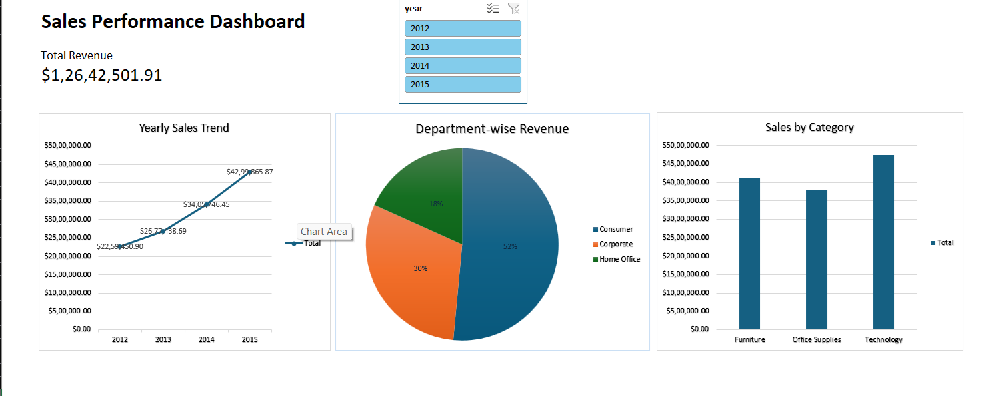

# Sales Performance Dashboard (Excel)

An interactive Excel dashboard built with Pivot Tables, Pivot Charts and a Slicer to analyse sales performance. This is my Week 1 project for the Data Analyst Course (Excel & Data Fundamentals).

## Dashboard Preview

## Dataset

- File: `Sales_Dashboard_project.xlsx`
- Sheet used: Orders (51,290 rows, orders from 2012 to 2015)
- Key columns used: Order Date, Category, Segment, Sales

## What the Dashboard Shows

1. Total Revenue: total sales across all orders
2. Sales by Category: Furniture, Office Supplies and Technology
3. Yearly Sales Trends: sales from 2012 to 2015
4. Department-wise Revenue: the dataset has no Department column, so Segment (Consumer, Corporate, Home Office) is used as the department

## Steps Followed

1. Opened the dataset and checked it for duplicates, blanks and wrong data types
2. Added a Year column using the YEAR formula
3. Converted the data into an Excel Table
4. Created four Pivot Tables: Total Revenue, Sales by Category, Department Revenue and Yearly Sales
5. Created Pivot Charts for the Yearly Sales, Category and Department pivots
6. Built a Dashboard sheet with the charts, the Total Revenue figure and a Year slicer connected to all pivots

## Key Insights

- Total revenue is about 1.26 crore (12.64 million)
- Technology has the highest sales, followed by Furniture and Office Supplies
- The Consumer segment brings in about 52% of revenue, Corporate about 30% and Home Office about 18%
- Sales grew every year from 2012 to 2015

## Tools Used

- Microsoft Excel (Tables, Pivot Tables, Pivot Charts, Slicers, formulas)
